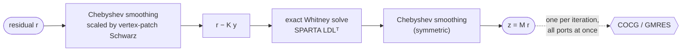

<div align="center">

# 🐦‍⬛ CORVID

### Fast, lean iterative solves for time-harmonic Maxwell

**C**oarse **O**perators by **R**ecursive **V**olume **I**nterpolation of **D**e Rham complexes

[](LICENSE)


</div>

---

CORVID solves the linear systems of frequency-domain electromagnetics: second-order Nédélec elements on
unstructured tetrahedral meshes, including absorbing boundaries, ports, PMLs and lossy materials. It
preconditions the **true, indefinite operator K** (no shifted operator) and solves it with COCG or GMRES. The
core is multithreaded Rust, behind a small Python API.

It is built for the regime where a direct solver works but costs too much memory, and where frequency
sweeps make you solve the same mesh many times. CORVID is the iterative solver of
[EMerge](https://github.com/FennisRobert/EMerge).

> **Status:** research code under active development. The API may still change.

## Why CORVID

| | |
|---|---|
| 🧠 **Less memory** | No full factorization of K. On the Weng filter benchmark the whole EMerge process peaked at 14.8 GB, against 22.4 GB with the direct solver. |
| ⚡ **Sweep-aware** | One solver lives across a frequency sweep. It refactors in place, keeps factors between nearby frequencies, and starts each solve from the best combination of earlier solutions. Iterations drop from ~13 to 3–5 across most of a band. |
| 🧵 **Uses its cores** | Every kernel is threaded. All ports are solved in lockstep, so the matrix and the block factors are read once per iteration for all of them. Thread count per solver: `threads=8`. |
| 🎯 **Exact where it matters** | An exact solve on the lowest-order (Whitney) edge unknowns, by [SPARTA](https://github.com/FennisRobert/SPARTA)'s sparse LDLᵀ. Optionally also on PML rows and on unknowns next to coarsely meshed metal walls. |
| 🔪 **Thin conductors** | Works with EMerge's `ThinConductor` DoF splitting. The split is described as a cut through the mesh, and the S-parameters match the direct solver to 6·10⁻⁸. |

## Benchmark

A microstrip coupled-line filter (Wei-Chung Weng): 573k unknowns, 22.9M nonzeros, 2 ports, a 71-point sweep
from 0.5 to 4.5 GHz. Run through EMerge on 8 threads of an Apple M3 Ultra:

| | Solver time, whole sweep | Per frequency | Peak RAM (whole process) |
|---|---|---|---|
| Direct (SPARTA LDLᵀ) | 138.8 s | 1.92 s | 22.4 GB |
| **CORVID** | **94.9 s** | 3.2 s (bottom of band) → **0.6 s** (top) | **14.8 GB** |

The peak-RAM figures are from an 11-point sweep. `bench/weng/` holds the model and the scripts to reproduce this.

## Install

Prebuilt wheels (macOS, Linux and Windows; Python 3.9 or later) are attached to each
[GitHub release](https://github.com/FennisRobert/Corvid/releases). Nothing is published to PyPI.

```sh
pip install corvid-solver --find-links https://github.com/FennisRobert/Corvid/releases/expanded_assets/v0.5.2
```

The package installs as `corvid-solver` and imports as `corvid`. (PyPI's `corvid` is an unrelated project.)

The coarse factorization uses BLAS: Accelerate on macOS, and elsewhere the `scipy-openblas32` wheel that
CORVID depends on, loaded at import. `corvid.blas_library()` reports which one is in use, and `CORVID_BLAS`
can point at another OpenBLAS or MKL library.

To build from source you need a Rust toolchain and network access (SPARTA is fetched from GitHub):

```sh
pip install .                       # or, for development: maturin develop --release
```

## Use

```python
import corvid

top = corvid.Topology.nedelec2(edges, tris, solve_ids, nodes=nodes)  # once per mesh
sol = corvid.Solver(top, method="cocg", threads=8)                   # COCG: K is complex symmetric

for K, b, k0 in sweep:            # K: the solved system (CSR or CSC), b: (n,) or (n, ports)
    sol.factorize(K, k0=k0)       # refactors in place, or keeps the factors of a nearby frequency
    x = sol.solve(b)              # all ports in lockstep, starting from earlier solutions
    print(sol.info)               # iterations and true relative residual per port
```

- **Layout.** `Topology.nedelec2` takes EMerge's second-order layout `[edge | edge | face | face]`. For any
  other layout, `corvid.Topology(dof_entity, dof_kind, edges, tris)` takes the mesh entity and kind of each
  unknown.
- **Threads.** `threads=n` sets the count per solver. `corvid.set_num_threads(n)` sets the default for
  solvers that don't set one.
- **Docs.** The user manual is coming. Until then, the docstrings of `corvid.Solver` describe every option,
  and [docs/INTERFACE.md](docs/INTERFACE.md) describes the EMerge wiring.

## How it works



1. **Vertex-patch Schwarz.** For every mesh vertex, all unknowns on its edges and faces form one block. Each
   block is factored exactly, as a sparse LDLᵀ with a minimum-degree ordering. Arnold, Falk and Winther showed
   that these patches capture the curl-free (gradient) fields that defeat pointwise smoothers.
2. **Chebyshev smoothing.** Fourth-kind Chebyshev polynomials (Phillips & Fischer) of the Schwarz-scaled
   operator, order 3 by default. The spectral bound comes from a short power iteration.
3. **Exact coarse level.** The residual on the lowest-order edge unknowns is solved exactly with SPARTA. PML
   rows can be added, and so can unknowns next to metal walls that are coarse relative to the wavelength.
4. **Krylov.** COCG for complex symmetric K (no basis to store), or GMRES. Each iteration does one operator
   product and one preconditioner application for all ports.
5. **Across a sweep.**
   - Same sparsity pattern: refactor in place, reusing SPARTA's analysis, the block orderings and the
     spectral estimate.
   - Within 20% in k0²: keep the factors and swap in only the new K. If convergence slows, it refactors and
     continues.
   - Each solve starts from the minimum-residual combination of the last solutions.

For meshes whose Whitney level is too large to factor, `corvid.amge` contains a prototype of the agglomerated
hierarchy that gives CORVID its name. Tetrahedra are grouped into polyhedral volumes, recursively. On every
level the coarse spaces commute exactly with gradient and curl, so each level is again an exact de Rham
complex (Pasciak & Vassilevski).

## Repository

```
corvid/              Python package: Topology, Solver, PML detection; amge/ prototype
src/                 Rust core (PyO3): sparse kernels, Schwarz blocks, Chebyshev, coarse solve, Krylov
tests/               test_api.py, test_sweep.py, test_wheel.py (+ one EMerge problem in tests/data/)
bench/weng/          the Weng filter benchmark: EMerge model, solver dumps, timing, copper vs direct
research/            experiments, probes and dataset generators behind the design (see docs/)
docs/                EMerge interface notes, research notes and the research notebook (Typst)
tools/               release helpers (third-party notices)
.github/workflows/   wheels for macOS, Linux and Windows, attached to GitHub releases
```

Tests: `python tests/test_api.py` and `python tests/test_sweep.py`. The full EMerge datasets (`data/aegis/`)
and the research datasets are not in the repository, so the tests use what is available.

## Credits and licence

CORVID is Copyright (C) 2026 Robert Fennis, and is free software: you can redistribute it and/or modify it
under the terms of the GNU Affero General Public License as published by the Free Software Foundation, either
version 3 of the License, or (at your option) any later version. The licence is in [LICENSE](LICENSE). CORVID
is distributed in the hope that it will be useful, but WITHOUT ANY WARRANTY.

The AGPL lets you use CORVID in open-source software under the same licence. Software that includes CORVID and
is distributed, or offered to users over a network, must make its own source available under the AGPL too. To
include CORVID in closed-source software, you need a commercial licence: email robertfennis@emerge-numerics.com.

**Built on.**
- **[SPARTA](https://github.com/FennisRobert/SPARTA)** by Robert Fennis and Milan Rother. It provides every
  sparse direct solve in CORVID.
- [PyO3](https://pyo3.rs), [rust-numpy](https://github.com/PyO3/rust-numpy),
  [rayon](https://github.com/rayon-rs/rayon) and [num-complex](https://github.com/rust-num/num-complex).
- [NumPy](https://numpy.org) and [SciPy](https://scipy.org).

**Methods** (algorithms followed, no code taken):
- Arnold, Falk & Winther: vertex-patch Schwarz for H(curl).
- Phillips & Fischer: fourth-kind Chebyshev smoothers.
- Hiptmair: distributive smoothing.
- Pasciak & Vassilevski, and LLNL's parELAG: exact de Rham sequences on agglomerates.
- AWS Labs' [Palace](https://github.com/awslabs/palace): the design of its p-multigrid preconditioner.
- van der Vorst & Melissen: COCG.
- Saad & Schultz: GMRES.

Full references are in [LICENSE-THIRD-PARTY](LICENSE-THIRD-PARTY), and the notices that ship with every
binary are in [THIRD-PARTY-NOTICES](THIRD-PARTY-NOTICES).

Much of the code was written with Claude (Anthropic), an AI model, under the direction of Robert Fennis.
